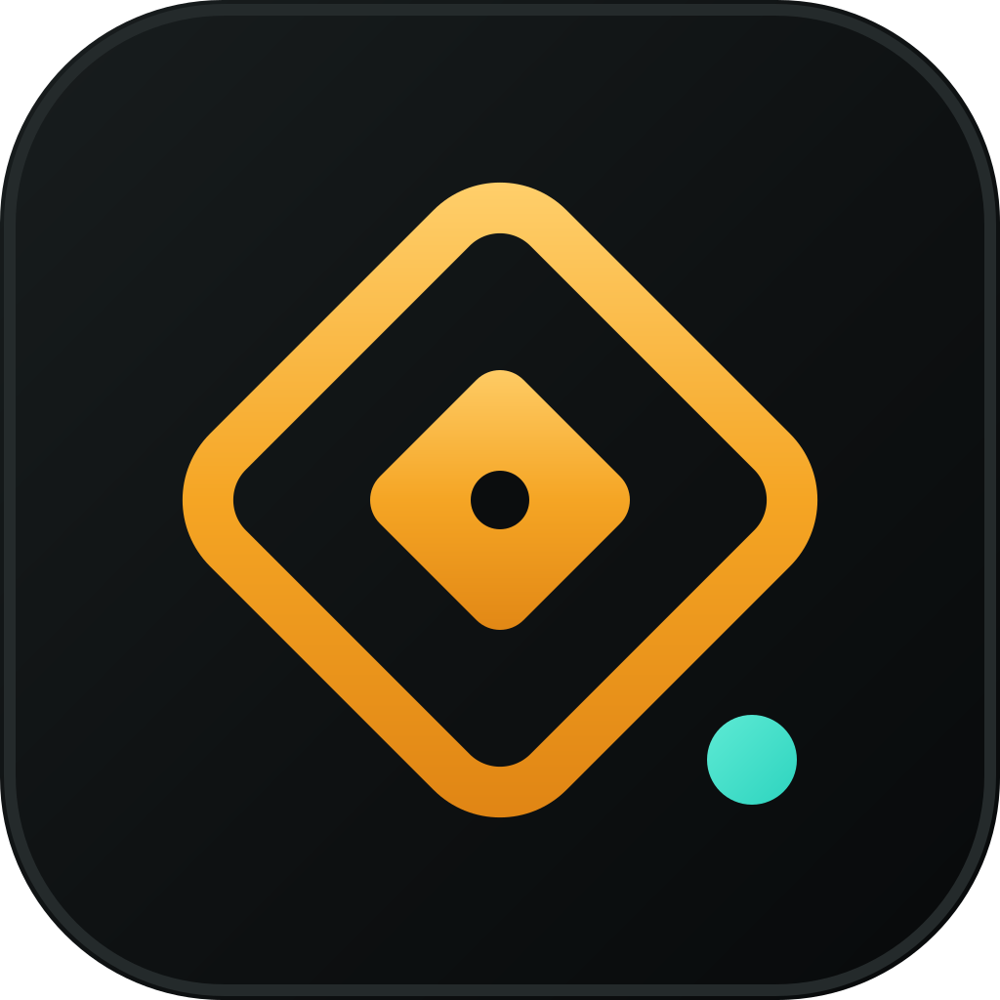

# Novelty

[](https://github.com/marwan343343chif-debug/Novelty/actions/workflows/ci.yml)

> A premium markdown studio for chapters, notes, and everything in between.

Novelty is a local-first desktop writing app for markdown and plain text. It
pairs an Obsidian-style workspace (linked notes, folders, tags, backlinks, a
local graph, writing widgets) with a clean, opencode-inspired dark UI. Your
vault lives in IndexedDB on your own machine — nothing is sent anywhere except
the searches you explicitly run in the Web search panel.



## Features

- **Editor** — CodeMirror 6 with markdown highlighting, live preview, split
  view, line numbers, wrapping, active-line highlight, and focus/typewriter
  modes.
- **Rendered markdown** — GFM tables, task lists, colored code, callouts,
  `==highlight==`, colored text, `[[wiki-links]]`, and `#tags`.
- **Organizing** — nested folders, favorites, tags, full-text search, recent
  notes, trash with restore, and quick switcher (`Ctrl/Cmd+O`) + command
  palette (`Ctrl/Cmd+P`).
- **Linking** — backlinks, outgoing links, and an interactive local graph.
- **Writing widgets** — aggregated to-do list, clock + Pomodoro timer, and a
  calendar that creates/opens daily notes.
- **Web search panel** — look up a term and get a short, readable summary plus a
  text result list, without leaving your notes.
- **Images** — paste/upload images, set note covers, and export notes with an
  `assets/` folder.
- **Data** — auto-save, automatic rotating backups, export a note as `.md`,
  export the whole vault as JSON, export every note as Markdown, and import a
  vault (merge or replace).
- **Themes** — OpenCode Dark, Graphite, and Paper, with an accent picker,
  density, content width, and font controls.

## Getting started

Requires Node.js 18+.

```bash
npm install     # install dependencies
npm run dev     # start in development with HMR
```

## Building

```bash
npm run typecheck   # type-check main/preload + renderer
npm run build       # build to out/
npm run dist        # package installers into release/
```

`npm run dist` uses `electron-builder.yml` and produces:

- **Linux** — AppImage (`.deb` available via `npx electron-builder --linux deb`)
- **macOS** — `.dmg`
- **Windows** — NSIS installer

> Note: the `.deb` target uses electron-builder's bundled `fpm`, which needs
> `libcrypt.so.1` (`libxcrypt-compat` on Arch) at build time. If that's missing
> on your system, stick with the AppImage.

App icons live in `build/` (`icon.png`, `icon.ico`, `icon.icns`, and
`build/icons/`).

## Data & backups

Your vault is stored locally in IndexedDB. On every launch — and before any
destructive action such as replacing the vault on import or erasing all data —
Novelty writes a rotating JSON backup to the app's user-data directory
(`<userData>/backups/novelty-<timestamp>.json`, newest 20 kept). To restore one,
open **Settings → Data → Import vault JSON** and pick the backup file, then
choose **Merge** or **Replace**.

On Linux the user-data directory is `~/.config/Novelty`, on macOS
`~/Library/Application Support/Novelty`, and on Windows
`%APPDATA%\Novelty`.

## Keyboard shortcuts

| Shortcut           | Action                  |
| ------------------ | ----------------------- |
| `Ctrl/Cmd+N`       | New note                |
| `Ctrl/Cmd+Shift+N` | New folder              |
| `Ctrl/Cmd+O`       | Quick switcher          |
| `Ctrl/Cmd+P`       | Command palette         |
| `Ctrl/Cmd+Shift+F` | Search all notes        |
| `Ctrl/Cmd+D`       | Daily note              |
| `Ctrl/Cmd+S`       | Save now                |
| `Ctrl/Cmd+E`       | Toggle source / preview |
| `Ctrl/Cmd+Shift+W` | Writing widgets         |
| `Ctrl/Cmd+Shift+\` | Toggle right sidebar    |
| `Ctrl/Cmd+Shift+K` | Insert image            |
| `Ctrl/Cmd+,`       | Settings                |
| `Esc`              | Close overlays          |

See **Help → Keyboard shortcuts** in the app for the full list.

## Tech stack

Electron · electron-vite · React 18 · TypeScript · Zustand · CodeMirror 6 ·
marked + DOMPurify + highlight.js · idb (IndexedDB) · react-resizable-panels ·
lucide-react · fuse.js.

## Project layout

```
src/
  main/      Electron main process — window, menus, IPC, web search
  preload/   contextBridge API (window.api)
  renderer/  React app (components, store, lib, styles)
build/       App icons and build resources
GUIDE.md     Authoritative design + build plan
```

## Security

The window is frameless with `contextIsolation: true` and
`nodeIntegration: false`; only whitelisted IPC channels are exposed through the
preload bridge.

## License

[MIT](LICENSE) © 2026 Sartre
